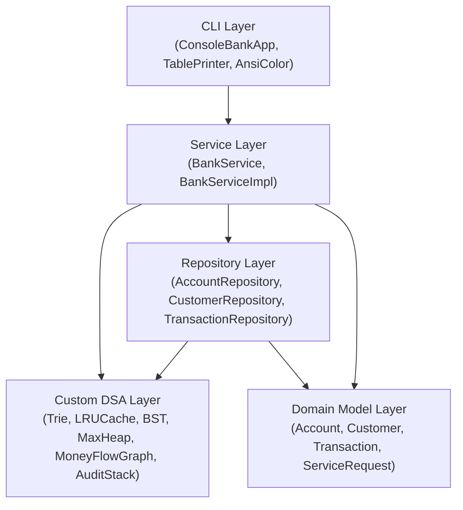

# 🏦 Enterprise CLI Banking System (DSA-Powered)

An enterprise-grade, high-performance Command Line Banking backend written in pure Core Java. This project is directly inspired by and builds upon the foundational banking domain from [Faisal Memon's 100-Day Java Backend Masterclass](https://github.com/buildwithfaisal/100-day-java-backend-masterclass/tree/main/java/bank-app), evolving it into an algorithmically optimized, production-patterned architecture powered by real-world **Data Structures and Algorithms (DSA)**.

---

## 📑 Table of Contents
1. [Project Overview & Motivation](#-project-overview--motivation)
2. [Architectural Overview](#-architectural-overview)
3. [Deep-Dive: Data Structures & Algorithms Applied](#-deep-dive-data-structures--algorithms-applied)
   - [1. Trie (Prefix Tree) — Customer Autocomplete](#1-trie-prefix-tree--customer-autocomplete)
   - [2. LRU Cache (DLL + HashMap) — Hot Account Caching](#2-lru-cache-doubly-linked-list--hashmap--hot-account-caching)
   - [3. Binary Search Tree — Range Queries on Balances](#3-binary-search-tree--range-queries-on-balances)
   - [4. Binary Max-Heap — VIP Customer Service Desk](#4-binary-max-heap--vip-customer-service-desk)
   - [5. Directed Graph (BFS & DFS) — Anti-Money Laundering (AML) Analysis](#5-directed-graph-bfs--dfs--anti-money-laundering-aml-analysis)
   - [6. LIFO Stack (Command Pattern) — Transaction Undo & Rollback](#6-lifo-stack-command-pattern--transaction-undo--rollback)
4. [Complexity Summary Table](#-complexity-summary-table)
5. [Comparison with Reference Bank App](#-comparison-with-reference-bank-app)
6. [Project Structure](#-project-structure)
7. [Getting Started & Running the Project](#-getting-started--running-the-project)
   - [Option A: Direct Java Compilation (Zero External Tools)](#option-a-direct-java-compilation-zero-external-tools)
   - [Option B: Using Maven](#option-b-using-maven)
   - [Option C: One-Click Run Scripts](#option-c-one-click-run-scripts)
8. [Running the Automated Test Suite](#-running-the-automated-test-suite)
9. [CLI Feature Walkthrough & Menu Guide](#-cli-feature-walkthrough--menu-guide)
10. [Key Design Patterns Utilized](#-key-design-patterns-utilized)

---

## 🌟 Project Overview & Motivation

In traditional beginner bank apps, data management is typically limited to in-memory `ArrayList`s or basic `HashMap`s with linear scans (`O(N)`). While suitable for tutorials, real-world financial core banking systems process millions of accounts and require:

- Sub-millisecond autocomplete for customer search without freezing the console.
- In-memory L1 caching to serve high-frequency ("hot") accounts without hitting disks.
- Fast range queries for wealth management and audit compliance.
- Strict priority queue scheduling for high-net-worth (VIP) clients.
- Forensic graph analysis to detect circular money laundering rings and fund trails.
- Atomic reversible audit trails allowing tellers to undo mistaken inputs.

This project implements all these capabilities natively in standard Java with **zero external dependencies**.

---

## 🏛 Architectural Overview

The application follows the **Layered Clean Architecture** pattern:



### Layer Responsibilities
* **`com.bank.cli`**: Formats interactive CLI menus, ASCII banners, colored status outputs, and auto-sizing tabular statements.
* **`com.bank.service`**: Encapsulates business logic, balance validation, state transitions, and coordination between repositories and DSA modules.
* **`com.bank.repository`**: Provides data access abstractions combining primary hash storage with secondary DSA indexes.
* **`com.bank.dsa`**: Clean, self-contained, custom-built data structures designed specifically for banking problem domains.
* **`com.bank.domain`**: Rich domain entities (`Account`, `Customer`, `Transaction`, `ServiceRequest`, and domain enums).
* **`com.bank.util`**: Validation helpers, ANSI color formatters, and table alignment renderers.
* **`com.bank.exception`**: Domain-specific unchecked exceptions (`InsufficientFundsException`, `AccountNotFoundException`, etc.).

---

## 🔬 Deep-Dive: Data Structures & Algorithms Applied

### 1. Trie (Prefix Tree) — Customer Autocomplete
* **Package**: `com.bank.dsa.Trie<V>`
* **The Banking Problem**:
  When a bank employee types "Al" into the search bar, the system must immediately suggest all matching customers ("Alice Smith", "Alexander Wright"). Scanning an `ArrayList` of 1,000,000 customer strings with `.startsWith()` requires $O(N \cdot L)$ string comparisons on every keystroke, degrading latency.
* **How It Works**:
  A tree where each node represents a character. Words sharing common prefixes share the same initial branch. In our implementation, both the full name and space-separated tokens (first name and last name) are indexed. Each node maintains a collection of payload references.
* **Complexity**:
  - Search Prefix: $O(P + K)$ where $P = \text{length of prefix}$ and $K = \text{number of matched records}$.
  - Independent of total customer count $N$.

```
           [root]
          /      \
        'a'      'b'
         |        |
        'l'      'o'
       /   \      |
     'i'   'e'   'b' -> [Bob]
     /       \
   'c'       'x' -> [Alexander]
   /
 'e' -> [Alice]
```

---

### 2. LRU Cache (Doubly Linked List + HashMap) — Hot Account Caching
* **Package**: `com.bank.dsa.LRUCache<K, V>`
* **The Banking Problem**:
  The 80/20 Pareto principle applies to banking: ~20% of accounts generate ~80% of daily transactions (salary deposits, merchant billings, ATM checks). Fetching records repeatedly from secondary storage is inefficient. An in-memory cache must retain the most active accounts and evict idle ones.
* **How It Works**:
  - **HashMap**: Provides $O(1)$ lookup mapping `accountNumber -> Node`.
  - **Doubly Linked List**: Maintains access recency.
    - `Head`: Most Recently Used (MRU) account.
    - `Tail`: Least Recently Used (LRU) account.
  - When an account is accessed (`get`), it is unlinked and spliced at `Head` in $O(1)$.
  - When cache capacity is exceeded upon `put`, the node right before `Tail` is evicted in $O(1)$.
* **Complexity**:
  - `get(key)`: $O(1)$
  - `put(key, value)`: $O(1)$
  - `remove(key)`: $O(1)$

---

### 3. Binary Search Tree — Range Queries on Balances
* **Package**: `com.bank.dsa.BinarySearchTree<K, V>`
* **The Banking Problem**:
  Financial compliance and wealth management frequently run range audits: *"Find all accounts with balances between \$5,000 and \$25,000"*. Filtering an unsorted list is $O(N)$.
* **How It Works**:
  - Accounts are ordered by their balance.
  - To handle duplicate balances (e.g. multiple accounts with \$1,000.00), each BST node holds a bucket `List<V>`.
  - **Range Pruning Algorithm**: During recursion, if `current.key < min`, the entire left subtree is discarded without traversal. If `current.key > max`, the entire right subtree is discarded.
* **Complexity**:
  - Average Range Query: $O(\log N + K)$, where $K$ is the number of qualifying accounts.
  - In-order traversal: $O(N)$ produces a fully sorted balance list.

---

### 4. Binary Max-Heap — VIP Customer Service Desk
* **Package**: `com.bank.dsa.MaxHeap<T>`
* **The Banking Problem**:
  In high-traffic customer support and relationship banking, requests cannot be served strictly First-Come, First-Served (FIFO). A Platinum VIP client facing a wire transfer issue must be routed to a senior relationship manager ahead of general inquiries.
* **How It Works**:
  - Complete binary tree implemented in a dynamic contiguous array.
  - Max-Heap property: Parent priority score $\ge$ children priority score.
  - For node at index $i$:
    - Left Child: $2i + 1$
    - Right Child: $2i + 2$
    - Parent: $\lfloor (i - 1) / 2 \rfloor$
  - Priority comparison ranks `PLATINUM(4) > GOLD(3) > SILVER(2) > REGULAR(1)`, using submission timestamp as a deterministic tie-breaker.
* **Complexity**:
  - Peek highest priority: $O(1)$
  - Insert new request (`siftUp`): $O(\log N)$
  - Dispatch highest priority request (`extractMax` with `siftDown`): $O(\log N)$

---

### 5. Directed Graph (BFS & DFS) — Anti-Money Laundering (AML) Analysis
* **Package**: `com.bank.dsa.MoneyFlowGraph`
* **The Banking Problem**:
  - **Money Trail Tracing**: When tracking stolen funds, investigators need the shortest chain of transfer hops between Account A and Account Z.
  - **AML Circular Ring Detection**: A common money laundering pattern ("smurfing" or "layering") bounces funds through intermediate dummy/mule accounts back to the perpetrator (`A -> B -> C -> A`) to obscure origins.
* **How It Works**:
  - **Graph Representation**: Adjacency list `Map<String, List<TransferEdge>>`.
  - **Shortest Path (BFS)**: Uses a queue and predecessor map to explore outward layer-by-layer, guaranteeing the shortest hop chain in $O(V + E)$.
  - **Cycle Detection (DFS with Backtracking)**: Explores transfer chains from a suspect account. If a directed path encounters the originating account again, an AML cycle alert is triggered.
* **Complexity**:
  - BFS Path Search: $O(V + E)$
  - DFS Cycle Detection: $O(V + E)$ where $V = \text{accounts}$, $E = \text{transfers}$.

---

### 6. LIFO Stack (Command Pattern) — Transaction Undo & Rollback
* **Package**: `com.bank.dsa.TransactionAuditStack`
* **The Banking Problem**:
  Tellers make typographical errors (e.g. entering \$1,000 instead of \$100, or selecting the wrong recipient). The system must allow immediate one-click rollbacks of recent operations while maintaining audit log integrity.
* **How It Works**:
  - Every mutation registers a `ReversibleAction` lambda onto a Last-In, First-Out (LIFO) stack.
  - Invoking Undo pops the most recent action, restores balances atomically, and writes an official `REVERSAL` transaction to the ledger.
* **Complexity**:
  - Push reversible operation: $O(1)$
  - Pop and execute rollback: $O(1)$

---

## 📊 Complexity Summary Table

| Operation / Feature | Underlying DSA | Time Complexity | Space Complexity | Real-World Benefit |
| :--- | :--- | :--- | :--- | :--- |
| **Customer Name Autocomplete** | Trie (Prefix Tree) | $O(P + K)$ | $O(\Sigma \cdot L \cdot N)$ | Instant search across millions of customer names |
| **Hot Account L1 Cache** | LRU Cache (DLL + HashMap) | $O(1)$ | $O(\text{Capacity})$ | Zero-delay lookups for frequent transactions |
| **Balance Range Inquiries** | Binary Search Tree | $O(\log N + K)$ | $O(N)$ | Prunes subtrees; fast audits and wealth tier queries |
| **VIP Support Triage** | Binary Max-Heap | $O(\log N)$ insert, $O(1)$ peek | $O(N)$ | Guarantees VIP clients are prioritized automatically |
| **Money Trail Search** | Directed Graph BFS | $O(V + E)$ | $O(V)$ | Forensic tracking of fund hops between accounts |
| **AML Circular Cycle Alert** | Directed Graph DFS | $O(V + E)$ | $O(V + E)$ | Unmasks money laundering layering rings |
| **Transaction Undo** | ArrayDeque Stack | $O(1)$ | $O(U)$ | Operational error recovery with audit integrity |

---

## ⚖ Comparison with Reference Bank App

| Feature | Reference Repo (`buildwithfaisal/bank-app`) | This CLI DSA Project |
| :--- | :--- | :--- |
| **User Interface** | Basic scanner loop | Color-coded interactive CLI with ASCII tables & diagnostics |
| **Customer Search** | Linear Stream filter ($O(N)$) | Custom Trie with tokenized prefix search ($O(P + K)$) |
| **Account Storage** | Raw `HashMap` without caching | Tiered L1 LRU Cache ($O(1)$) + Primary Hash Index |
| **Balance Inquiries** | Linear scan | Binary Search Tree with branch-pruning range queries |
| **Priority Handling** | None | Binary Max-Heap priority queue based on customer tier |
| **AML & Fraud Detection**| None | Directed Money Flow Graph with BFS trail & DFS cycle detection |
| **Operational Rollback**| None | Command Pattern undo stack with `REVERSAL` audit trail |
| **Demo Dataset** | None (manual input required) | 1-Click synthetic seeder with accounts, transfers, and cycles |
| **Automated Tests** | None | Standalone test runner verifying all DSA structures |

---

## 📁 Project Structure

```
bank-app-cli/
├── pom.xml                                   # Maven build file (Java 17+)
├── run.bat                                   # Windows one-click compile & launch script
├── run.sh                                    # Unix/macOS one-click compile & launch script
├── README.md                                 # In-depth project documentation
└── src/
    ├── main/java/com/bank/
    │   ├── cli/
    │   │   └── ConsoleBankApp.java           # Interactive CLI menu & terminal driver
    │   ├── domain/
    │   │   ├── Account.java                  # Financial account entity
    │   │   ├── AccountType.java              # SAVINGS, CHECKING, FIXED_DEPOSIT enum
    │   │   ├── Customer.java                 # Customer profile entity
    │   │   ├── CustomerTier.java             # REGULAR, SILVER, GOLD, PLATINUM enum
    │   │   ├── ServiceRequest.java           # Priority desk support ticket
    │   │   ├── Transaction.java              # Ledger audit entry
    │   │   └── TransactionType.java          # DEPOSIT, WITHDRAWAL, TRANSFER, REVERSAL
    │   ├── dsa/
    │   │   ├── BinarySearchTree.java         # BST supporting duplicate keys & range pruning
    │   │   ├── LRUCache.java                 # Custom Doubly Linked List + HashMap cache
    │   │   ├── MaxHeap.java                  # Array-backed Binary Max-Heap
    │   │   ├── MoneyFlowGraph.java           # Directed Graph with BFS shortest path & DFS cycles
    │   │   ├── TransactionAuditStack.java    # LIFO stack for Command Pattern rollbacks
    │   │   └── Trie.java                     # Prefix Tree for instant name autocomplete
    │   ├── exception/
    │   │   ├── AccountFrozenException.java
    │   │   ├── AccountNotFoundException.java
    │   │   ├── BankException.java            # Base unchecked banking exception
    │   │   ├── DuplicateAccountException.java
    │   │   ├── InsufficientFundsException.java
    │   │   └── ValidationException.java
    │   ├── repository/
    │   │   ├── AccountRepository.java        # Coordinates HashMap, LRU Cache & BST index
    │   │   ├── CustomerRepository.java       # Coordinates HashMap & Prefix Trie
    │   │   └── TransactionRepository.java    # Coordinates Ledger, Graph & Undo Stack
    │   ├── service/
    │   │   ├── BankService.java              # Service layer business interface
    │   │   └── BankServiceImpl.java          # Core implementation of banking operations
    │   └── util/
    │       ├── AnsiColor.java                # Terminal color styling & escape sequences
    │       ├── TablePrinter.java             # ASCII auto-sizing table renderer
    │       └── Validation.java               # Email, name, and numerical input validators
    └── test/java/com/bank/
        └── AppTestSuite.java                 # Comprehensive zero-dependency test runner
```

---

## 🚀 Getting Started & Running the Project

### Prerequisites
- Java Development Kit (JDK) 17 or higher.
- Terminal with ANSI color support (standard in Windows Terminal, PowerShell, CMD, macOS Terminal, and Linux Bash).

---

### Option A: Direct Java Compilation (Zero External Tools)

Open PowerShell, Command Prompt, or Bash in the `bank-app-cli` directory:

```bash
# 1. Compile all Java source files into an 'out' directory
javac -d out $(find src/main/java -name "*.java")    # Linux / macOS / Git Bash
# OR on Windows PowerShell:
Get-ChildItem -Recurse -Filter *.java src\main\java | Resolve-Path | ForEach-Object { $_.Path } | Out-File -Encoding ascii sources.txt; javac -d out @sources.txt; Remove-Item sources.txt

# 2. Run the Console Application
java -cp out com.bank.cli.ConsoleBankApp
```

---

### Option B: Using Maven

```bash
# Compile and launch using Maven exec plugin
mvn clean compile exec:java
```

Or build a standalone executable JAR:

```bash
mvn clean package
java -jar target/bank-app-cli-1.0.0.jar
```

---

### Option C: One-Click Run Scripts

* **Windows**: Double-click `run.bat` or run:
  ```cmd
  run.bat
  ```
* **macOS / Linux**:
  ```bash
  chmod +x run.sh
  ./run.sh
  ```

---

## 🧪 Running the Automated Test Suite

The project includes a standalone test suite that validates all DSA data structures and banking logic without external test libraries:

```bash
# Compile test sources
javac -d out $(find src/main/java src/test/java -name "*.java")    # Linux / macOS
# Windows:
Get-ChildItem -Recurse -Filter *.java src | Resolve-Path | ForEach-Object { $_.Path } | Out-File -Encoding ascii test_sources.txt; javac -d out @test_sources.txt; Remove-Item test_sources.txt

# Execute test suite
java -cp out com.bank.AppTestSuite
```

### Expected Output:
```
=======================================================
        RUNNING DSA & BANK SERVICE TEST SUITE
=======================================================

[1] Trie (Prefix Tree)
  ✔ [PASS] Trie prefix search for 'Al' finds Alice and Alexander
  ✔ [PASS] Trie prefix search for token 'Hamilton'
  ✔ [PASS] Trie search for non-existent prefix returns empty

[2] LRU Cache
  ✔ [PASS] LRU Cache get existing items
  ✔ [PASS] LRU Cache evicts least recently accessed item when full
  ✔ [PASS] LRU Cache hit rate tracking

[3] Binary Search Tree (Range Query)
  ✔ [PASS] BST Range Query [400 - 3000] finds middle accounts
  ✔ [PASS] BST in-order traversal yields sorted elements

[4] Binary Max-Heap (Priority Queue)
  ✔ [PASS] Max-Heap extracts Platinum VIP first, then Gold, then Regular

[5] Money Flow Graph (AML & Shortest Path)
  ✔ [PASS] Graph BFS finds shortest path from A to D
  ✔ [PASS] Graph DFS detects circular AML ring (C -> A)

[6] Transaction Audit Stack (Undo)
  ✔ [PASS] Undo executes last command

[7] Bank Service Financial Operations
  ✔ [PASS] Deposit and balance update
  ✔ [PASS] Transfer and balance integrity
  ✔ [PASS] Undo reverses the transfer

=======================================================
TEST RESULTS: 15 Passed | 0 Failed
=======================================================
```

---

## 💻 CLI Feature Walkthrough & Menu Guide

When you launch `ConsoleBankApp`, the main navigation menu appears:

```
================================================================================
   ____            _        ____              _    _             ____  _     ___ 
  | __ )  __ _ _ __| | __   / ___| _   _  ___ | |_ | |__   ___  / ___|| |   |_ _|
  |  _ \ / _` | '__| |/ /   \___ \| | | |/ _ \| __|| '_ \ / _ \ | |    | |    | | 
  | |_) | (_| | |  |   <     ___) | |_| | (_) | |_ | |_) |  __/ | |___ | |___ | | 
  |____/ \__,_|_|  |_|\_\   |____/ \__, |\___/ \__||_.__/ \___|  \____||_____|___|
                                   |___/                                          
                 DSA-Powered Enterprise Banking System (CLI)
================================================================================

========================== MAIN NAVIGATION MENU ==========================
 [ 1] Open New Account                   [ 7] Search Customers (Trie Autocomplete)
 [ 2] View Account Statement             [ 8] Range Search Balances (BST Query)
 [ 3] Deposit Funds                      [ 9] VIP Priority Service Desk (Max-Heap)
 [ 4] Withdraw Funds                     [10] AML Fraud & Money Trail (Graph BFS/DFS)
 [ 5] Transfer Funds                     [11] Diagnostics & LRU Cache Telemetry
 [ 6] Undo Last Operation (Stack)        [12] 1-Click Load Realistic Demo Dataset
 [ 0] Exit System
==========================================================================
```

### Quick Test Tour (Recommended Workflow)
1. **Press `12` (Load Realistic Demo Dataset)**:
   Instantly populates 6 accounts (`AC-100001` to `AC-100006`), diverse VIP customer tiers, inter-account transfers, and an intentional AML circular transfer ring.
2. **Press `7` (Trie Customer Search)**:
   Type `Al` to see instant $O(P + K)$ autocomplete matching "Alice Smith" and "Alexander Wright".
3. **Press `8` (BST Range Query)**:
   Enter Min: `1000` and Max: `15000` to retrieve accounts with balances inside that interval in $O(\log N + K)$ time.
4. **Press `9` (VIP Priority Service Desk)**:
   Select option `2` (`extractMax`). Notice how Platinum VIP consultation requests are dispatched first, ahead of older Regular requests.
5. **Press `10` (AML Fraud & Forensic Graph)**:
   - Select option `1` (BFS shortest path) between `AC-100001` and `AC-100006`.
   - Select option `2` (DFS cycle detection) for account `AC-100001`. The system detects the circular transfer ring:
     `AC-100001 ──► AC-100002 ──► AC-100003 ──► AC-100001`.
6. **Press `6` (Undo Operation)**:
   Test reversing transactions safely with the Command Pattern stack.
7. **Press `11` (System Diagnostics)**:
   Inspect live LRU Cache metrics: hit counts, miss counts, hit-rate percentage, and cache evictions.

---

## 📐 Key Design Patterns Utilized

1. **Repository Pattern**:
   Separates data storage mechanisms from domain business logic. Enables swapping in-memory data structures with database persistence (e.g. PostgreSQL, Redis) without altering the `BankService` layer.
2. **Command Pattern**:
   Encapsulates financial state mutations as reversible objects pushed onto the `TransactionAuditStack`, enabling reliable operational rollbacks.
3. **Strategy / Enum with Behavior**:
   `AccountType` and `CustomerTier` encapsulate business rules (interest rates, minimum balances, priority weights) directly within domain types.
4. **Sentinel Node Pattern**:
   `LRUCache` utilizes dummy `head` and `tail` nodes to eliminate null checks and edge-case branches during node insertion and removal.

---

## 📜 License
This project is open-source educational software distributed under the MIT License. Feel free to use, modify, and expand upon it for your backend masterclass studies, portfolio, and DSA interviews!
